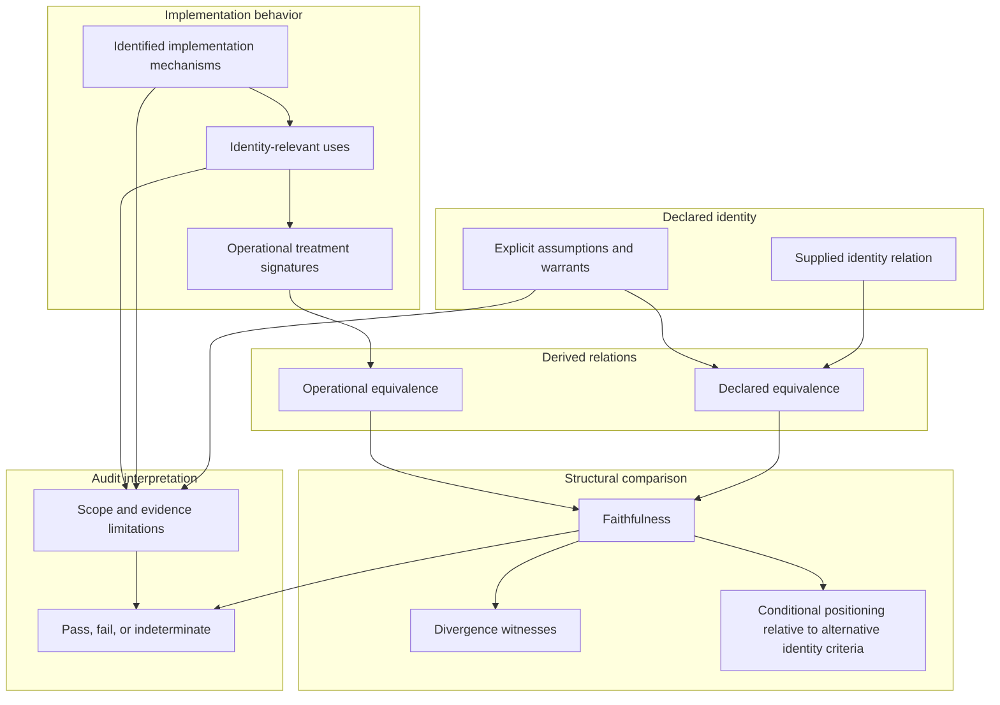

# SE Theory: Operational Identity

> Lean 4 formalization of the Operational Identity layer of
> Structural Explainability theory.

Record systems may declare when two records should be treated as referring
to the same thing, while their implementations may behave differently.

This repository formalizes how to compare declared identity relations with
identity-relevant behavior induced by examined implementation mechanisms.
It studies when implementations respect declared rules of sameness,
when they introduce distinctions those rules do not make,
and when the available evidence is insufficient to decide.

Lean source files under `SE/` are authoritative for formal definitions,
predicates, assumptions, theorems, and proof obligations.

- [GitHub Repository](https://github.com/structural-explainability/se-theory-operational-identity)
- [Paper: Operational Identity (arXiv:2607.20729)](https://arxiv.org/abs/2607.20729)
- [Persistence Theory](https://github.com/structural-explainability/se-theory-persistence)
- [SE-210 Finite-Core Verification](https://github.com/structural-explainability/se-verification-operational-identity)

## Operational Identity

Operational Identity distinguishes what a record system declares about
sameness from how its implementation actually treats records.

A declared identity relation specifies which records are considered
the same under a supplied identity criterion.

An implementation may assign identifiers, resolve references, select
identity rules, or determine whether a record continues across a change.
These identity-relevant behaviors can induce an operational equivalence
relation over the examined records.

The theory compares the declared and operational relations.

An implementation surface is **faithful** when it does not distinguish
records that the declared relation treats as the same.

A **divergence witness** identifies a pair of records that the
declaration relates but the examined implementation surface separates.

These judgments are relative to the supplied declaration, the examined
domain, and the identified implementation behavior.

The theory does not establish whether the declared identity criterion
correctly identifies its intended referents. Nor does it certify that
every identity-relevant mechanism or use in an implementation has been
observed.

## Theory Structure

The diagram summarizes the intended conceptual structure of the theory.
Arrows indicate relationships among definitions and audit inputs,
not logical implications or claims that all results have been proved.

Formal results establish mathematical consequences of supplied relations
and assumptions. Their application to actual record systems requires
independent justification of the identity criteria, implementation
observations, and audit boundaries.

## Relationship to Other Theories

Operational Identity builds on Persistence theory, which supplies
foundational identity relations and commitment reasoning.

Operational Identity does not redefine persistence. Its responsibility
is to characterize relationships between declared identity and
identity-relevant treatment induced by implementations.

Other Structural Explainability theories may supply identity criteria,
transformation interpretations, or referential judgments through
separately justified connections.

The general audit does not require a particular identity-regime
inventory, transformation-classification matrix, or sibling relation.

## Scientific Status

The theory is under initial development.

Mathematical correctness, scientific adequacy, and theoretical
contribution are evaluated separately.

Successful Lean verification establishes that formal results follow
from their stated assumptions. It does not establish that those
assumptions are scientifically adequate for a particular record system.

Any unresolved connection between formal identity relations and
real-world referents remains an explicit scientific obligation.

## Scope

Repository scope is defined in `SE_MANIFEST.toml`.

## Exclusions

Repository exclusions are defined in `SE_MANIFEST.toml`.

## Import

Downstream Lean projects should import the public surface:

`import SE.OperationalIdentity`
